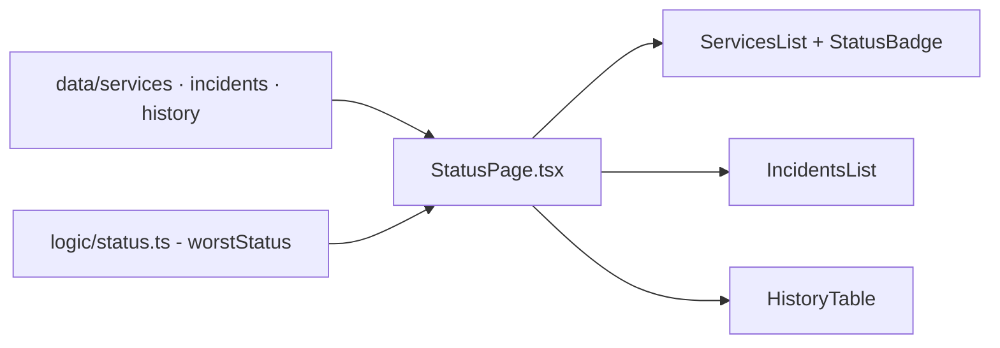

# pagina-status-sistema

**English** · [Português (Brasil)](README.md)

    

## What it is

**A system status page** (in the style of public status pages): a **React 18 + TypeScript SPA** that shows **per-service uptime**, **incidents** and availability **history**. Sample data lives in `src/data`; state aggregation (worst status wins) is in `src/logic/status.ts` and is tested with Vitest.

## Status

A working prototype with sample data; tests passing (3 suites: incidents, services, status).

## Features

- **Status aggregation** (`logic/status.ts`): `worstStatus` — the worst state (`operacional` < `degradado` < `indisponível`) becomes the overall state.
- **Services** (`components/ServicesList.tsx`, `ServiceCard.tsx`): a card per service with a state badge (`StatusBadge`).
- **Incidents** (`IncidentsList.tsx`, `IncidentCard.tsx`): an incident list with descriptions.
- **History** (`HistoryTable.tsx`): a past-availability table.
- **Sample data** (`data/services.ts`, `data/incidents.ts`, `data/history.ts`).

## Architecture

A React SPA assembled by Vite. `StatusPage.tsx` composes the lists; the pure logic (`worstStatus`) is isolated in `logic/` for DOM-free testing.



## Stack

- React 18.3, TypeScript 5.5
- Vite 5.4, Vitest 2.0
- No runtime dependencies beyond React

## Repository layout

```
pagina-status-sistema/
├── src/
│   ├── logic/status.ts        # state aggregation
│   ├── components/            # StatusPage, ServicesList, IncidentsList, HistoryTable...
│   ├── data/                  # services, incidents, history (samples)
│   └── types.ts · App.tsx · main.tsx
├── test/ (incidents · services · status)
├── index.html · vite.config.ts · tsconfig.json
└── package.json
```

## Prerequisites and installation

Node.js ≥ 18.

```bash
npm install
```

## How to run

```bash
npm run dev        # dev server
npm run build      # production build (tsc + vite)
npm run preview    # serve the build
```

## Tests and quality

```bash
npm test
# Vitest: 3 suites (incidents, services, status)
```

## Technical decisions and trade-offs

- **Pure logic separated** (`logic/status.ts`): testable without rendering.
- **Static data in `src/data`**: no backend; swapping in an API is just replacing the imports.

## Known limitations and roadmap

- Data is hard-coded (no real uptime checks or incident API).
- No auto-refresh/polling.

## Development process

An individual project by Kelvin Oliveira, built with orchestrated AI agents and reviewed by the author.

## License and author

MIT — Copyright (c) 2026 Kelvin Oliveira. Author: [Kelvin Oliveira](https://github.com/KelvinOliveiraCode) · [Portfolio](https://kelvinoliveiracode.github.io/portfolio/)
