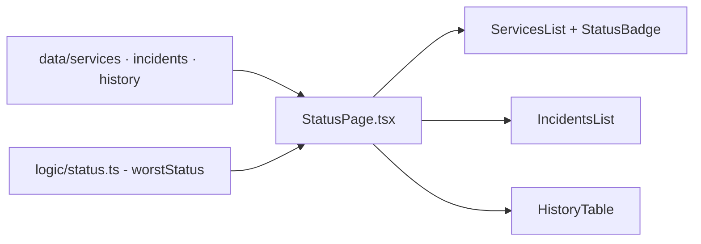

# pagina-status-sistema

[English](README.en.md) · **Português (Brasil)**

    

## O que é

**Página de status de sistema** (estilo status pages públicas): uma **SPA em React 18 + TypeScript** que exibe **uptime por serviço**, **incidentes** e **histórico** de disponibilidade. Dados de exemplo em `src/data`; a agregação de estado (pior estado vence) fica em `src/logic/status.ts` e é testada com Vitest.

## Status

Protótipo funcional com dados de exemplo; testes passando (3 suítes: incidents, services, status).

## Funcionalidades

- **Agregação de status** (`logic/status.ts`): `worstStatus` — o pior estado (`operacional` < `degradado` < `indisponível`) vira o estado geral.
- **Serviços** (`components/ServicesList.tsx`, `ServiceCard.tsx`): cartão por serviço com badge de estado (`StatusBadge`).
- **Incidentes** (`IncidentsList.tsx`, `IncidentCard.tsx`): lista de incidentes com descrição.
- **Histórico** (`HistoryTable.tsx`): tabela de disponibilidade passada.
- **Dados de exemplo** (`data/services.ts`, `data/incidents.ts`, `data/history.ts`).

## Arquitetura

SPA React montada pelo Vite. `StatusPage.tsx` compõe as listas; a lógica pura (`worstStatus`) é isolada em `logic/` para testes sem DOM.



## Stack

- React 18.3, TypeScript 5.5
- Vite 5.4, Vitest 2.0
- Sem dependências de runtime além de React

## Estrutura do repositório

```
pagina-status-sistema/
├── src/
│   ├── logic/status.ts        # agregação de estado
│   ├── components/            # StatusPage, ServicesList, IncidentsList, HistoryTable...
│   ├── data/                  # services, incidents, history (exemplos)
│   └── types.ts · App.tsx · main.tsx
├── test/ (incidents · services · status)
├── index.html · vite.config.ts · tsconfig.json
└── package.json
```

## Pré-requisitos e instalação

Node.js ≥ 18.

```bash
npm install
```

## Como executar

```bash
npm run dev        # dev server
npm run build      # build de produção (tsc + vite)
npm run preview    # serve o build
```

## Testes e qualidade

```bash
npm test
# Vitest: 3 suítes (incidents, services, status)
```

## Decisões técnicas e trade-offs

- **Lógica pura separada** (`logic/status.ts`): testável sem renderização.
- **Dados estáticos em `src/data`**: sem backend; trocar por uma API é substituir os imports.

## Limitações conhecidas e roadmap

- Dados fixos no código (sem checagem real de uptime ou API de incidentes).
- Sem atualização automática/polling.

## Processo de desenvolvimento

Projeto individual de Kelvin Oliveira, construído com agentes de IA orquestrados e revisado pelo autor.

## Licença e autor

MIT — Copyright (c) 2026 Kelvin Oliveira. Autor: [Kelvin Oliveira](https://github.com/KelvinOliveiraCode) · [Portfólio](https://kelvinoliveiracode.github.io/portfolio/)
